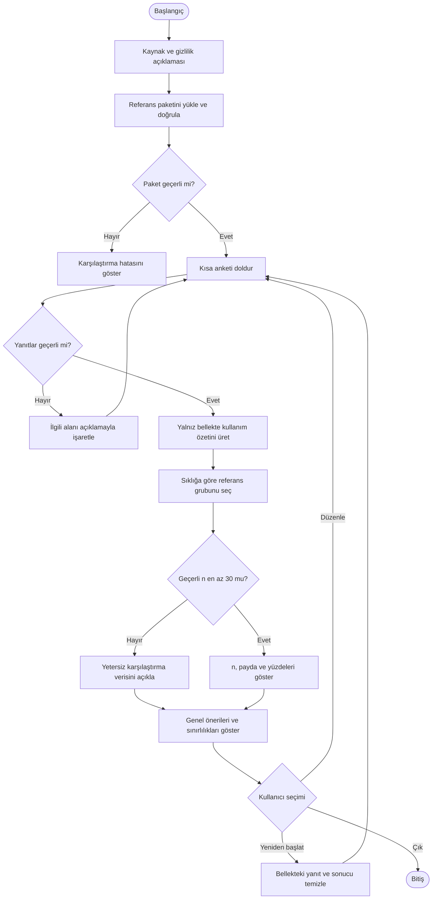
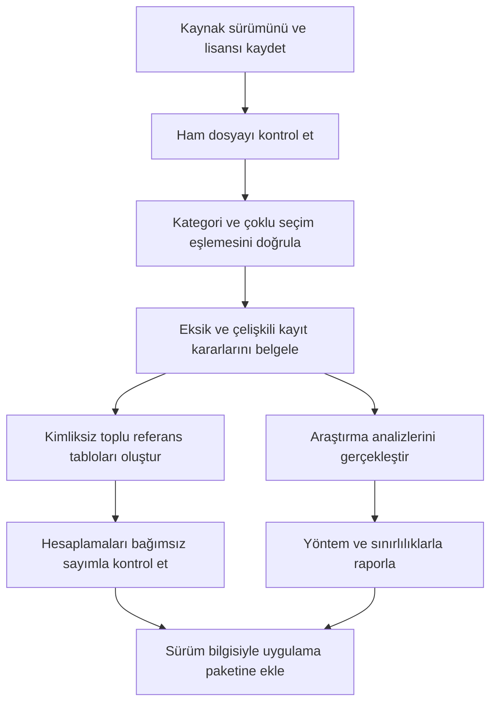

# Kullanıcı ve veri hazırlama akışları

Sürüm 2.0 · Aşağıdaki Mermaid gösterimi bir faaliyet akışıdır.

## Kullanıcı akışı

Geri/ileri gezinme ve yenilemede yanıtların geri gelmemesi ayrıca test edilecektir. URL, depolama ve ağ üzerinden anket yanıtı taşınmaz.

## Referans hazırlama akışı

