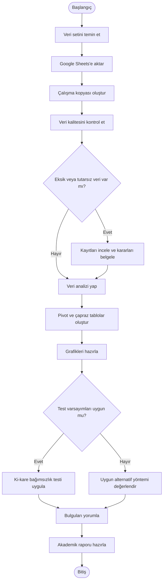

# UML ACTIVITY (FAALİYET) DİYAGRAMI

**Proje:** Yapay Zekâ Kullanım Alışkanlıkları, Tercihleri ve Kullanıcı Endişelerinin Veri Analizi

**Belge Sürümü:** 1.0

---

## <u>1. DİYAGRAMIN AMACI</u>

Bu diyagram, veri setinin temin edilmesinden akademik raporun hazırlanmasına kadar olan iş akışını göstermektedir.

İşlemlerin sırası, veri kalitesi kontrolü ve istatistiksel test varsayımlarına ilişkin karar noktaları modellenmiştir.

## <u>2. FAALİYET DİYAGRAMI</u>

## <u>3. KARAR NOKTALARI</u>

**Karar 1 — Veri kalitesi:** Eksik veya tutarsız yanıtlar varsa kayıtlar incelenir ve veri temizleme kararları belgelenir.

**Karar 2 — İstatistiksel test:** Ki-kare bağımsızlık testinin varsayımları kontrol edilir. Varsayımlar uygun değilse alternatif yöntemler değerlendirilir.

## <u>4. MEVCUT DURUM</u>

Veri aktarımı, ilk veri kalitesi kontrolleri ve kullanım sıklığına ilişkin ilk analiz tamamlanmıştır.

Diğer analizler, hipotez testleri ve akademik raporlama planlanmaktadır.

---

**Belge Türü:** UML Activity  
**Durum:** İlk taslak
