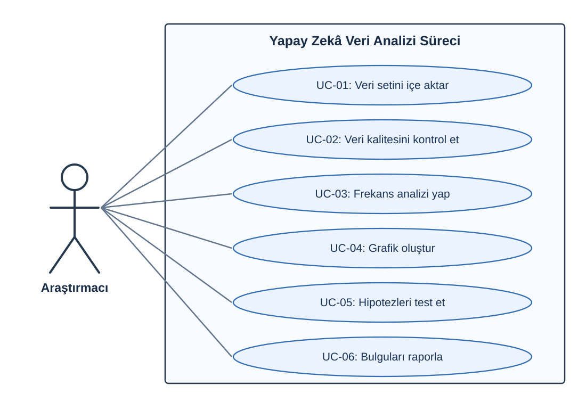
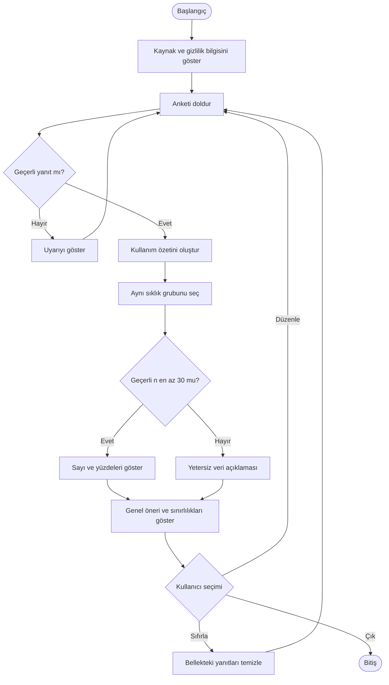
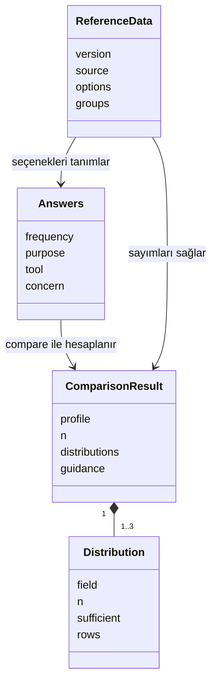

# Tasarım, kullanım senaryoları ve UML

## Kullanım senaryosu (UC) ne demek?

UC, Use Case kısaltmasıdır: bir aktörün sistemle ne yaptığını anlatır. Kullanıcıya gösterilen ekran adı veya kod değildir.

| UC | Aktör | Eylem | İlgili gereksinim |
|---|---|---|---|
| UC-01 | Ziyaretçi | Kaynak ve gizlilik bilgisini okur | NF1, NF4 |
| UC-02 | Ziyaretçi | Anketi doldurur ve yanıtını düzeltir | F1 |
| UC-03 | Ziyaretçi | Kullanım özeti, karşılaştırma ve öneriyi görür | F2–F5 |
| UC-04 | Ziyaretçi | Yanıtı düzenler veya testi sıfırlar | F6 |
| UC-05 | Ziyaretçi | Araştırma sonuçlarını inceler | F7 |
| UC-06 | Ekip | Kaynak veriyi uygulama için hazırlar | NF4 |

Ekip aktörü canlı kullanıcı yanıtlarına erişmez; veri hazırlama geliştirme aşamasında yapılır.

## Activity: uygulamanın iş akışı

## Class: mantıksal veri ilişkileri

Bu, JavaScript nesnelerinin mantıksal modelidir; kodda bulunmayan `class` tanımları varmış gibi sunulmaz. `src/engine.js` içindeki `validate` ve `compare` fonksiyonları bu nesnelerle çalışır. `src/app.js` form ve ekran yönetimini yapar. Her nesnenin kod karşılığı sunumda gösterilebilir.

## Mimari kararı

HTML/CSS/JavaScript ve statik veri paketi seçildi. Kurulum ve sunucu kodu ihtiyacı azdır; Seyfettin modülleri ayrı ayrı geliştirebilir. Hesaplama tarayıcıda yapılır. Python yalnız kaynak CSV'den toplu referans ve araştırma analizi üretmek için kullanılır. Araştırma sonuçları kullanıcı formu doldurulduğunda tekrar test edilmez.

Veri depolayan arka uç, kullanıcı hesabı veya dış AI API'si yoktur. Yerel HTTP sunucusu statik dosya servis eder; uygulama yanıtı alan bir uç nokta içermez.
