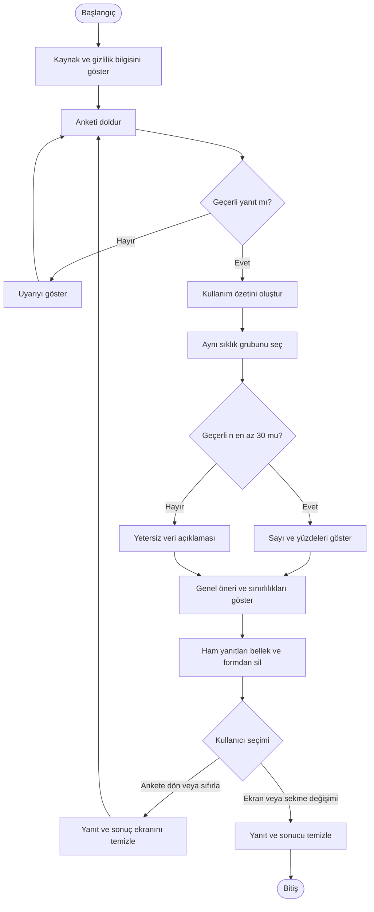
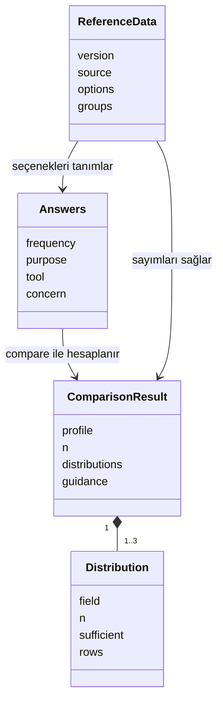

# Tasarım, kullanım senaryoları ve UML

## Kullanım senaryosu (UC) ne demek?

UC, Use Case kısaltmasıdır: bir aktörün sistemle ne yaptığını anlatır. Kullanıcıya gösterilen ekran adı veya kod değildir.

| UC | Aktör | Eylem | İlgili gereksinim |
|---|---|---|---|
| UC-01 | Ziyaretçi | Kaynak ve gizlilik bilgisini okur | NF1, NF4 |
| UC-02 | Ziyaretçi | Anketi doldurur, yanıtlarını kontrol eder | F1 |
| UC-03 | Ziyaretçi | Kullanım özeti, karşılaştırma ve öneriyi görür | F2–F5 |
| UC-04 | Ziyaretçi | Yeni ankete başlar | F6 |
| UC-05 | Ziyaretçi | Araştırma sonuçlarını inceler | F7 |

Diyagramda beş ziyaretçi işlemi var. Referans paketi hazırlamayı ayrı gösteriyoruz çünkü bunu uygulamayı geliştirirken ekip yapıyor. Ekip, canlı kullanıcı yanıtlarına erişmiyor.

### Kısa kullanım senaryoları

| İşlem | Normal akış | Alternatif durum |
|---|---|---|
| UC-01 Kaynak ve gizlilik | Ziyaretçi kaynak ve gizlilik açıklamasını okur. | Kaynak bağlantısını açabilir. Bağlantıya geçiş önceki yanıt/sonucu temizler. |
| UC-02 Anket | Seçenekleri işaretler. Anket sırasında önceki soruya dönüp seçimini değiştirebilir. | Boş veya uyumsuz yanıt varsa uyarı görür. Hiç kullanmayanlara güncel araç/amaç soruları zorlanmaz. |
| UC-03 Sonuç | Kullanım özeti, aynı sıklık grubunun dağılımı ve ayrı genel öneri görünür. | Geçerli grup 30 kişiden küçükse yüzde gösterilmez. |
| UC-04 Yeni anket | Ankete döner ve boş başlangıç görür. | Önceki sonuçtaki seçimler geri yüklenmez. |
| UC-05 Araştırma | Üç araştırma sorusunu, sonucu ve sınırlılıkları okur. | Bu ekrana geçiş önceki yanıt/sonucu temizler. |

**Veri hazırlama:** Ekip kaynak CSV'yi kontrol eder, `scripts/prepare_data.py` ile toplu referansı üretir ve sayımları inceler. Bu geliştirme işidir. Yeni ziyaretçilerin yanıtları bu dosyaya eklenmez.

**Temizleme bir kullanıcı işlemi değildir:** Kullanıcı yeni ankete başlamak ister. Belleği, formu ve sonuç ekranını kod temizler. Bu yüzden Use Case adını “Yeni ankete başla” olarak kullandık.

## Activity: işlemler hangi sırayla ilerliyor?

Bu diyagram anketin doldurulmasından sonuca kadar olan sırayı gösteriyor. Boş yanıt uyarısı ve yeni ankete dönüş de akışın parçası.

## Class: kodda hangi veri yapıları var?

`Answers` seçimleri, `ReferenceData` toplu referansı, `ComparisonResult` hesaplanan sonucu, `Distribution` ise bir sorunun sayı ve oran dağılımını temsil ediyor.

Bu, JavaScript nesnelerinin mantıksal modelidir; kodda bulunmayan `class` tanımları varmış gibi sunulmaz. `src/engine.js` içindeki `validate` ve `compare` fonksiyonları bu nesnelerle çalışır. `src/app.js` form ve ekran yönetimini yapar. Her nesnenin kod karşılığı sunumda gösterilebilir.

## Mimari kararı

HTML/CSS/JavaScript ve statik veri paketi seçildi. Kurulum ve sunucu kodu ihtiyacı azdır; Seyfettin modülleri ayrı ayrı geliştirebilir. Hesaplama tarayıcıda yapılır. Python yalnız kaynak CSV'den toplu referans ve araştırma analizi üretmek için kullanılır. Araştırma sonuçları kullanıcı formu doldurulduğunda tekrar test edilmez.

Veri depolayan arka uç, kullanıcı hesabı veya dış AI API'si yoktur. Yerel HTTP sunucusu statik dosya servis eder; uygulama yanıtı alan bir uç nokta içermez.
