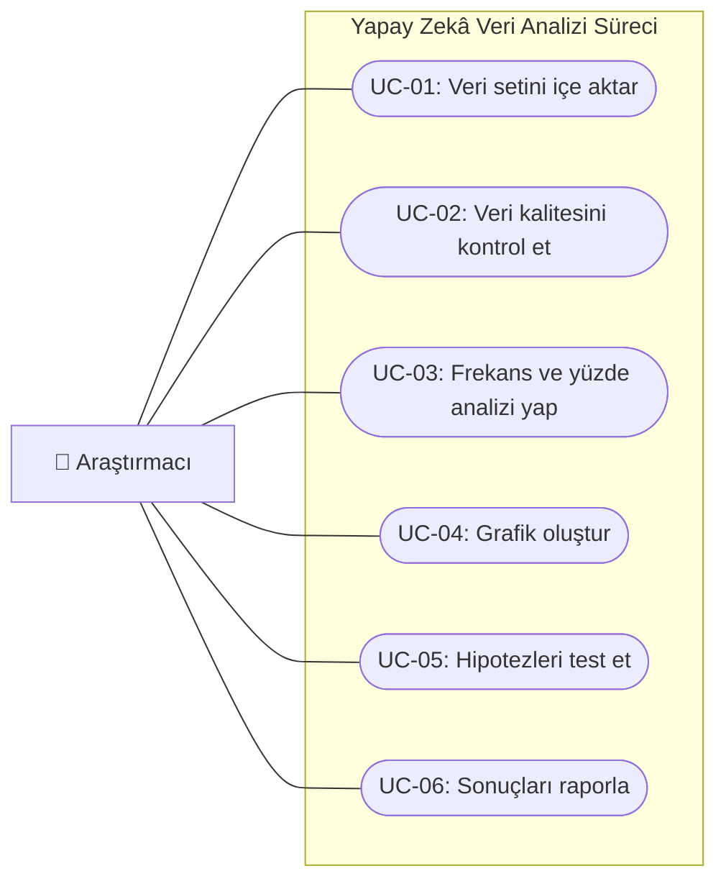

# UML USE CASE DİYAGRAMI

## <u>1. DİYAGRAMIN AMACI</u>

Bu diyagram, Yapay Zekâ Kullanım Alışkanlıkları, Tercihleri ve Kullanıcı Endişelerinin Veri Analizi projesinde araştırmacının gerçekleştirdiği temel işlemleri göstermektedir.

## <u>2. AKTÖRLER</u>

**Araştırmacı:** Veri setini hazırlayan, analizleri gerçekleştiren ve bulguları raporlayan proje ekibi üyesidir.

## <u>3. KULLANIM DURUMLARI</u>

| Kod | Kullanım durumu | Açıklama |
|---|---|---|
| UC-01 | Veri setini içe aktar | CSV/XLSX verilerini Google Sheets'e aktarır. |
| UC-02 | Veri kalitesini kontrol et | Eksik ve tutarsız yanıtları inceler. |
| UC-03 | Frekans ve yüzde analizi yap | Kullanım dağılımlarını hesaplar. |
| UC-04 | Grafik oluştur | Analiz sonuçlarını görselleştirir. |
| UC-05 | Hipotezleri test et | İstatistiksel ilişkileri değerlendirir. |
| UC-06 | Sonuçları raporla | Bulguları akademik rapora aktarır. |

## <u>4. UML USE CASE DİYAGRAMI</u>

**Not:** Mermaid gösterimi, kullanım durumlarının GitHub üzerinde görselleştirilmesi için hazırlanmıştır. Resmî UML Use Case gösteriminde aktör çöp adam, kullanım durumları oval ve sistem sınırı dikdörtgen şeklindedir.

## <u>5. PROJEYLE İLİŞKİSİ</u>

Bu kullanım durumları, `gereksinim-analizi.md` dosyasında belirtilen fonksiyonel gereksinimlere dayanmaktadır.

Diyagram, mevcut Google Sheets tabanlı analiz sürecinin kavramsal modelidir.

---

**Belge Türü:** UML Use Case  
**Durum:** İlk sürüm
