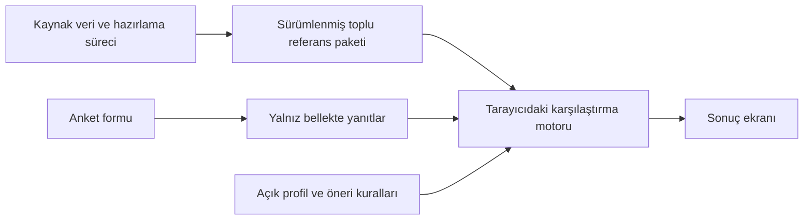
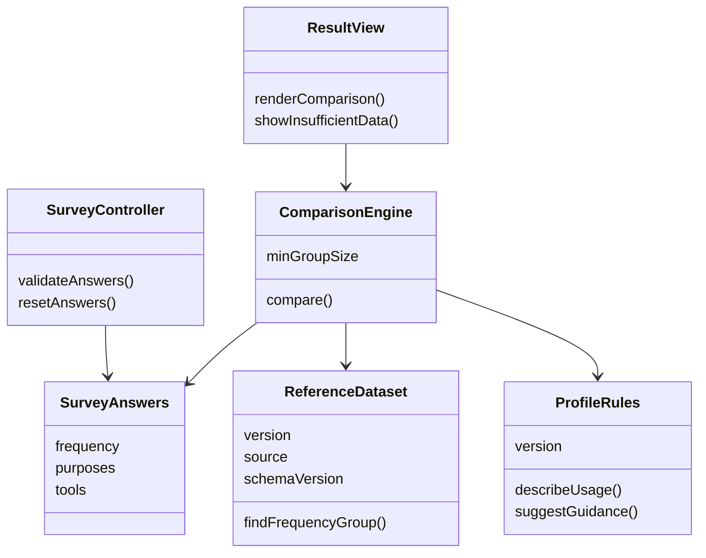

# Mimari ve sınıf modeli

Durum: önerilen tasarım; henüz uygulama kodu yoktur.

## Statik uygulama mimarisi

HTML/CSS/JavaScript arayüz, açık kurallar ve kimliksiz referans tabloları aynı statik uygulamada dağıtılır. Tarayıcı, başlangıçta referans paketini okuyabilir; anket yanıtlarını ağ isteklerine eklemez. Sunucu tarafında yanıt işleme veya veri tabanı bulunmaz.



## Mantıksal sınıf modeli



Bu sınıflar sorumlulukları ifade eder; uygulamada JavaScript modülleriyle gerçekleştirilebilir. Bir model eğitimi veya gizli puanlama yoktur.

## Önerilen dosya yapısı

```text
index.html
src/            # form, karşılaştırma, kurallar ve sonuç görünümü
assets/         # yerel stiller ve görseller
data/           # onaylı kimliksiz toplu referans paketi
scripts/        # veri hazırlama ve kontrol adımları
tests/          # hesaplama, veri yetersizliği ve gizlilik testleri
docs/           # yöntem, UML ve sunum
```

Veri şeması doğrulanmadan sabit soru seçenekleri veya gerçek sonuçlar yayımlanmayacaktır. Dış font, izleme kodu, reklam ve üçüncü taraf sonuç API'si kullanılmayacaktır.
