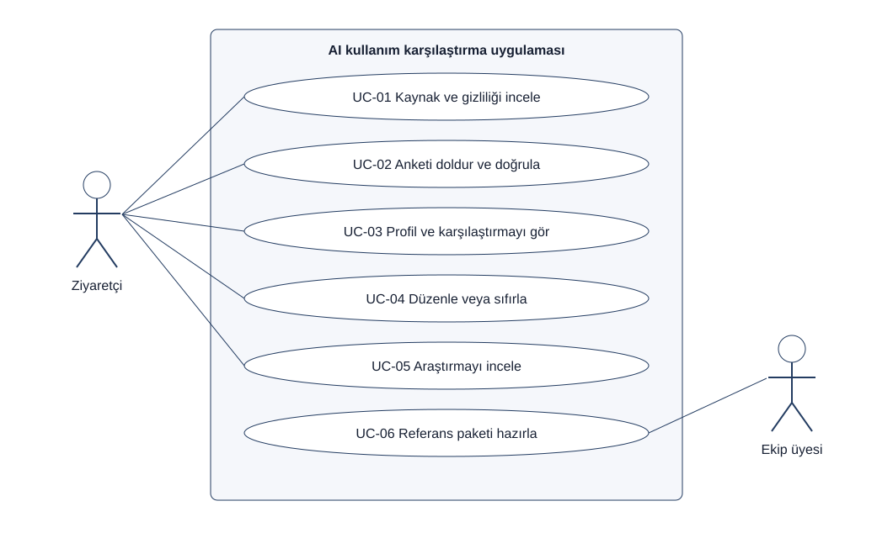

# Kullanım durumları

Sürüm 2.0 · Sistem: Yapay zekâ kullanım karşılaştırma uygulaması

## UML kullanım durumu diyagramı

Aktörler sistem sınırının dışındadır. Ziyaretçi uygulamayı kullanır; ekip üyesi referans paketini geliştirme aşamasında hazırlar. Bu aktör canlı kullanıcı yanıtlarını görüntülemez.

| Kod | Aktör | Kullanım durumu | Gereksinim |
|---|---|---|---|
| UC-01 | Ziyaretçi | Kaynak ve gizliliği incele | FR-01 |
| UC-02 | Ziyaretçi | Anketi doldur ve doğrula | FR-02, FR-03 |
| UC-03 | Ziyaretçi | Kullanım özeti ve karşılaştırmayı gör | FR-04–FR-08 |
| UC-04 | Ziyaretçi | Yanıtları düzenle veya sıfırla | FR-09 |
| UC-05 | Ziyaretçi | Araştırma sonuçlarını incele | FR-10 |
| UC-06 | Ekip üyesi | Referans paketi ve yöntemi hazırla | FR-11, FR-12 |

## Ana senaryo

Ön koşul: kaynak ve kuralları doğrulanmış referans paketi yüklenmiştir.

1. Ziyaretçi açıklamaları okur ve anketi doldurur.
2. Uygulama seçenekleri doğrular; geçersizse ilgili soruya döner.
3. Geçerli yanıtlar tarayıcı belleğinde değerlendirilir.
4. Aynı kullanım sıklığına sahip referans grubu seçilir.
5. Kullanım özeti, grup büyüklüğü ve uygun dağılımlar gösterilir.
6. Öneriler ayrı bir genel rehberlik alanında gösterilir.
7. Kullanıcı düzenler veya testi sıfırlar.

Alternatifler: geçerli grup n<30 ise yüzdeler gösterilmez; dosya/şema hatasında karşılaştırma durdurulur; “kullanmıyorum” yanıtında amaç zorunlu tutulmaz. Sistem hiçbir durumda varsayımsal yüzde üretmez.

Son koşul: sonuç yalnızca aktif sayfa belleğindedir. Kullanıcı yanıtları kaydedilmemiştir.
